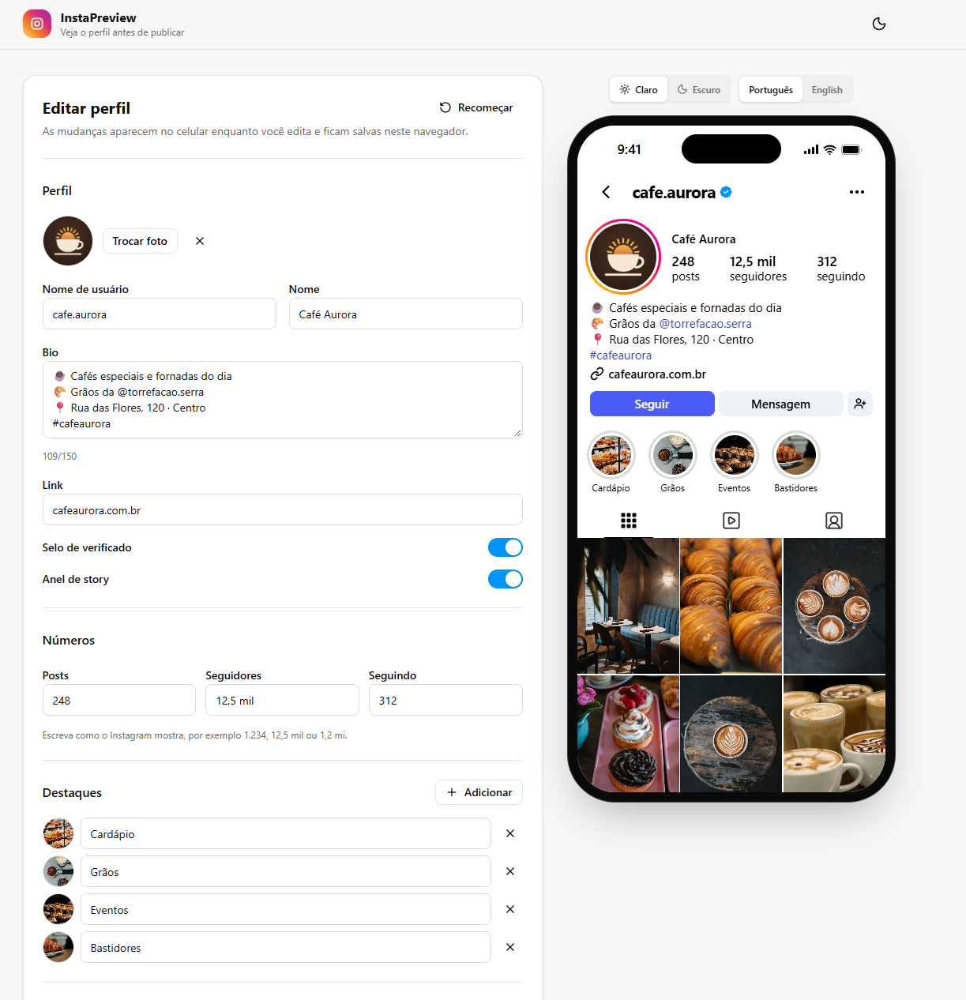

# InstaPreview

[](https://github.com/BryanGab0/instagram-profile-preview/actions/workflows/ci.yml)
[](LICENSE)

Preview how an Instagram profile will look before you publish it. Built for social media managers who plan feeds and need client approval before posting anything.

**[Open the app →](https://instapreview-app.vercel.app)**



## Features

- **Faithful preview.** A replica of a profile as visitors see it on iOS, with sizes, spacing and colors measured from the current app.
- **Full profile editing.** Avatar, username, name, bio with highlighted @mentions and #hashtags, link, stats, verified badge and story ring.
- **Highlights** with custom covers.
- **Post grid** in Instagram's 3:4 format. Upload many images at once and reorder them by dragging or with the arrow buttons.
- **Light and dark** Instagram themes, independent from the site theme.
- **Portuguese and English** preview text.
- **Saved in your browser.** Close the tab and come back later; your profile is still there.

## Privacy

Everything runs in your browser. Images are resized on your device and stored locally in IndexedDB. Nothing is uploaded to a server.

## Getting started

Requirements: Node.js 22 or later.

```bash
git clone https://github.com/BryanGab0/instagram-profile-preview.git
cd instagram-profile-preview
npm install
npm run dev
```

## Scripts

| Command                | Description                             |
| ---------------------- | --------------------------------------- |
| `npm run dev`          | Start the development server            |
| `npm run build`        | Type-check and build for production     |
| `npm run preview`      | Serve the production build locally      |
| `npm test`             | Run the test suite once                 |
| `npm run test:watch`   | Run tests on every file change          |
| `npm run lint`         | Lint with ESLint                        |
| `npm run typecheck`    | Type-check with TypeScript              |
| `npm run format`       | Format the code with Prettier           |
| `npm run format:check` | Check formatting without changing files |

## Tech stack

React 19, TypeScript, Vite, Tailwind CSS 4, Vitest and Testing Library.

## Project structure

```
src/
├── components/
│   ├── editor/   # Edit panel sections
│   ├── layout/   # Header, theme toggle, preview controls
│   ├── preview/  # iPhone mockup and Instagram profile replica
│   └── ui/       # Generic building blocks (Button, Input, Switch…)
├── constants/    # Example profile
├── hooks/        # useProfile, usePersistentProfile, useTheme…
├── lib/          # Images, storage and small utilities
├── pages/        # Home page
├── state/        # Profile reducer (pure, fully tested)
└── types/        # Domain types
```

## Contributing

Contributions are welcome. Please read the [contributing guide](CONTRIBUTING.md) before opening a pull request.

## License

[MIT](LICENSE)

This project is not affiliated with, endorsed by or sponsored by Instagram or Meta. Instagram is a trademark of Meta Platforms, Inc.
